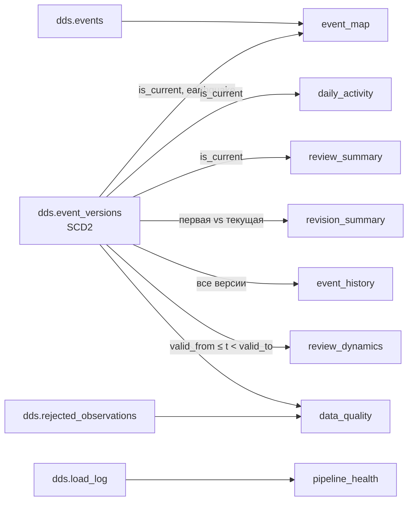

# CDM и дашборд — роль 3

Код витрин: [sql/cdm_load.sql](../sql/cdm_load.sql), выполняется задачей `dds_to_cdm`
целиком в одной транзакции. Проверки: [scripts/check_cdm.py](../scripts/check_cdm.py).
План работы и сценарий защиты: [role3_plan.md](role3_plan.md).

## Витрины



| Таблица | Зерно | Ключевые поля | Источник |
|---|---|---|---|
| `event_map` | текущее землетрясение | `event_time, latitude, longitude, magnitude, mag_class, depth_class, review_status, network_code, versions_cnt` | `event_versions` (is_current) + `events` |
| `daily_activity` | дата UTC × сеть × `mag_bin` × класс глубины | `events_cnt, reviewed_cnt, mag_filled_cnt, place_filled_cnt, revised_cnt, sum_mag, max_mag, sum_depth_km, max_depth_km` | is_current |
| `review_summary` | сеть × возраст события (сутки) × класс магнитуды | `events_cnt, reviewed_cnt, reviewed_share, data_as_of` | is_current |
| `revision_summary` | текущее землетрясение | `versions_cnt, first/current_magnitude, magnitude_delta, status_changed, depth_delta_km, location_shift_km, hours_to_review` | все версии |
| `event_history` | версия текущего землетрясения | `version_no, valid_from, valid_to, is_current, magnitude, magnitude_change, review_status, status_change` | все версии |
| `review_dynamics` | час наблюдения × сеть × класс магнитуды | `events_cnt, reviewed_cnt, automatic_cnt, mag_filled_cnt` | все версии, time travel |
| `pipeline_health` | запуск STG → DDS | `run_kind, rows_read, rows_rejected, rows_stale, new_events, versions_inserted, versions_closed` | `load_log` |
| `data_quality` | проверка | `check_group, check_name, records_cnt, total_cnt, share` | `rejected_observations`, `event_versions` |

### Определения метрик

- **Событие** — текущая версия (`is_current`) с `event_type = 'earthquake'`. Прочие типы
  (взрывы, карьеры) не входят в аналитику и показаны в `data_quality`.
- **mag_bin** — нижняя граница корзины магнитуды с шагом 0,5 (`floor(mag*2)/2`); фильтр
  «магнитуда от» на корзинах точен для значений, кратных 0,5. NULL — отдельная корзина.
- **mag_class**: `1. M<2.5`, `2. M2.5–4`, `3. M4–5`, `4. M5–6`, `5. M6+`, `6. нет данных`.
  **depth_class**: `<70`, `70–300`, `≥300 км`, `нет данных`. Номер в начале задаёт сортировку.
- **Доля reviewed** = `reviewed_cnt / events_cnt`; знаменатель — все события группы,
  включая `automatic` и `deleted`. При агрегации считать через суммы, а не среднее долей.
- **Средняя магнитуда/глубина** = `sum_mag / mag_filled_cnt`: NULL не участвует и не считается нулём.
- **Возраст события** — полные сутки от `event_time` до `data_as_of` (последний запуск DDS).
- **Уточнённое событие** — более одной версии в DDS; `magnitude_delta = текущая − первая`.
  `hours_to_review` — часы от первого наблюдения до версии со статусом reviewed, если
  событие пришло не reviewed. Всё это — только за период наблюдения нашим пайплайном.
- **review_dynamics** — состояние каталога на момент `snapshot_at` (каждый час и момент
  последней загрузки): какие версии были текущими тогда. Показывает ценность SCD2.

Витрины пересобираются полностью (`TRUNCATE` + `INSERT`) в одной транзакции: повторный
запуск даёт тот же результат, ошибка оставляет прежние данные. Таблицы не пересоздаются,
поэтому карточки Metabase не теряют поля. Если меняется структура витрины, при разработке
выполнить `DROP TABLE cdm.<имя>` вручную и перезапустить задачу.

## Metabase: сборка одной командой

Дашборды собираются скриптом [scripts/setup_metabase.py](../scripts/setup_metabase.py) через API
Metabase — руками ничего настраивать не нужно, а настройки воспроизводимы на любом ноутбуке.
Нужен только Python 3 (без сторонних библиотек), окружение поднято и `dds_to_cdm` хотя бы раз успешен:

```bash
python scripts/setup_metabase.py
```

Скрипт:

1. При первом запуске регистрирует администратора Metabase. Логин и пароль — `METABASE_ADMIN_EMAIL`
   и `METABASE_ADMIN_PASSWORD` из `.env` (учебные значения в `.env.example`, только localhost).
2. Подключает БД «Earthquakes CDM»: host `warehouse`, port `5432`, database `earthquakes`,
   user/password `bi_reader`. Metabase видит **только схему `cdm`** — это и есть проверка прав.
3. Синхронизирует схему, ставит полям `latitude`/`longitude` типы Latitude/Longitude (для карт),
   включает списки значений для фильтров «Сеть» и «Глубина».
4. Создаёт коллекцию «LR3 Землетрясения»: 27 SQL-карточек и два дашборда.

Повторный запуск архивирует прежние карточки и пересобирает дашборды **на тех же адресах**:
обычно `http://localhost:3334/dashboard/3` (основной) и `/dashboard/2` (история события) —
скрипт печатает точные ссылки. SQL каждой карточки — в словаре `C` скрипта.

## Дашборд «Сейсмическая активность USGS»

Фильтры сверху действуют на все вкладки: **Дата** (любой период), **Магнитуда от**
(по `magnitude` или корзине `mag_bin`), **Сеть**, **Глубина**. У каждой карточки есть
описание (значок ⓘ) — что показано и как считать.

| Вкладка | Карточки | Витрины |
|---|---|---|
| **Обзор** | пояснение конвейера; KPI: событий, макс. и средняя M, доля reviewed, уточнено, последняя загрузка; карта 2000 сильнейших событий; события по дням (stacked по классам M); глубина очагов (donut); магнитуда × глубина (scatter); 20 сильнейших | `daily_activity`, `event_map`, `pipeline_health` |
| **Проверка USGS** | доля reviewed; статусы (donut); доля reviewed по сетям; доля reviewed vs возраст события; **динамика доли reviewed по часам (SCD2 time travel)**; полнота полей по дням | `daily_activity`, `event_map`, `review_summary`, `review_dynamics` |
| **Уточнения (SCD2)** | уточнено событий; что меняется (M/статус/глубина/координаты); распределение Δ M; таблица уточнённых событий | `revision_summary` |
| **Качество и конвейер** | последняя загрузка; исключённые типы (взрывы, карьеры…); версии SCD2 по запускам; проверки качества; журнал запусков | `data_quality`, `pipeline_health` |

### Интерактивность

| Действие | Результат |
|---|---|
| Клик по столбцу дня в «Событий в день» | фильтр «Дата» = этот день на всём дашборде |
| Клик по сектору «Глубина очагов» | фильтр «Глубина» |
| Клик по столбцу сети в «Доля reviewed по сетям» | фильтр «Сеть» — например, `nc` показывает, что Северная Калифорния проверяет события только через ~10 суток |
| Клик по `event_id` в «Сильнейших» или «Уточнённых событиях» | переход на дашборд «История события» с этим событием |
| Клик по «Месту» в «Сильнейших» | страница события на сайте USGS |
| Наведение на точку карты / столбец | подсказка со всеми полями строки |

Metabase запоминает последние значения фильтров у пользователя: перед показом сбросьте
их крестиком у фильтра.

## Дашборд «История события (SCD2)»

Фильтр **Событие** (`event_id`); по умолчанию — самое уточнённое событие на момент сборки.
Слева — список уточнённых событий (клик выбирает событие), справа — магнитуда по версиям
(ступенчатая линия по `valid_from`) и положение эпицентра по версиям, внизу — таблица версий
с интервалами `[valid_from, valid_to)`, изменением магнитуды и сменой статуса. Источник — `cdm.event_history`.

### Соответствие требованиям исходной лабы

| Требование | Где на дашборде |
|---|---|
| Доля «одобренных» | KPI «Доля reviewed», статусы, доля по сетям |
| Доля «некорректных» | «Проверки качества»: отбраковка с причиной, неполные поля |
| Динамика доли заполненных аннотаций | «Полнота данных по дням» |
| Динамика доли одобренных | «Доля reviewed по часам наблюдения (SCD2)», «… vs возраст события» |
| Разрезы | фильтры Дата, Магнитуда, Сеть, Глубина |

## Проверки

```bash
docker compose exec -T airflow-scheduler python < scripts/check_cdm.py
```

Скрипт в отдельной временной БД проверяет: отсутствие обращений к STG в `cdm_load.sql`;
пустой DDS; только текущие землетрясения в карте; категорию «нет данных»; сходимость
сумм CDM с DDS; среднее без NULL; повторный запуск; отсутствие задвоения при уточнении;
первую и текущую версию в `revision_summary`; знаменатель доли reviewed; time travel по
часовым срезам; откат при ошибке; доступ `bi_reader` только к CDM.

Сверка на реальных данных:

```sql
SELECT (SELECT count(*) FROM dds.event_versions WHERE is_current AND event_type='earthquake') AS dds,
       (SELECT count(*) FROM cdm.event_map) AS cdm_map,
       (SELECT sum(events_cnt) FROM cdm.daily_activity) AS cdm_daily;
```

