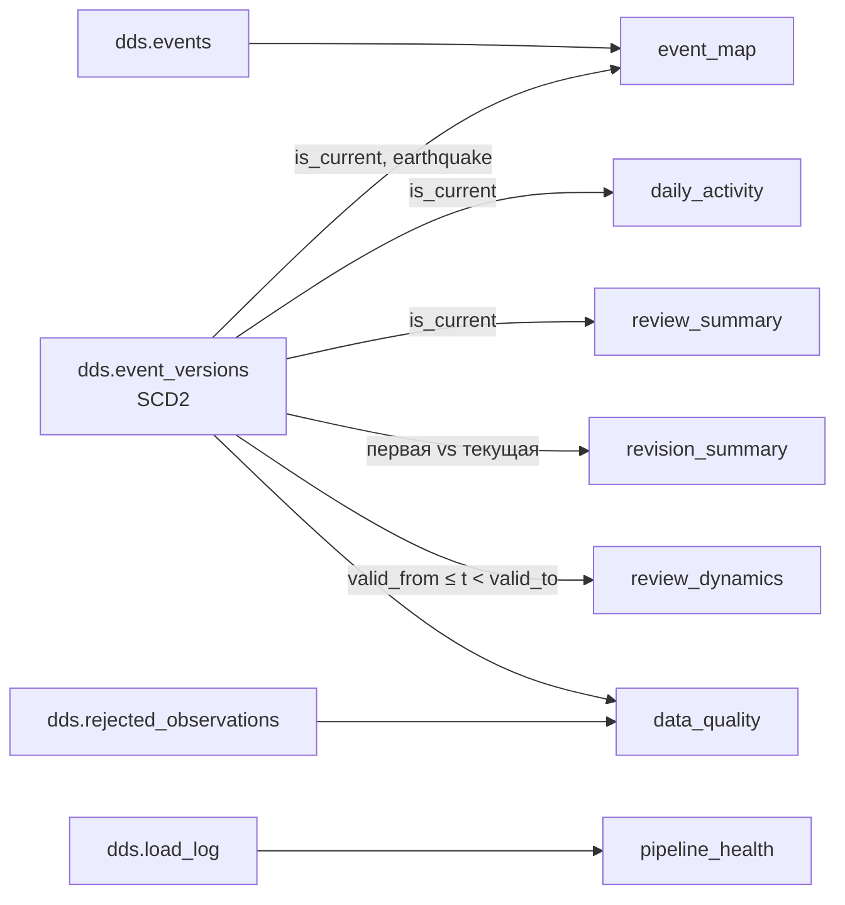

# CDM и дашборд — роль 3

Код витрин: [sql/cdm_load.sql](../sql/cdm_load.sql), выполняется задачей `dds_to_cdm`
целиком в одной транзакции. Проверки: [scripts/check_cdm.py](../scripts/check_cdm.py).
План работы и сценарий защиты: [role3_plan.md](role3_plan.md).

## Витрины



| Таблица | Зерно | Ключевые поля | Источник |
|---|---|---|---|
| `event_map` | текущее землетрясение | `event_time, latitude, longitude, magnitude, mag_class, depth_class, review_status, network_code, versions_cnt` | `event_versions` (is_current) + `events` |
| `daily_activity` | дата UTC × сеть × `mag_bin` × класс глубины | `events_cnt, reviewed_cnt, mag_filled_cnt, place_filled_cnt, revised_cnt, sum_mag, max_mag, sum_depth_km, max_depth_km` | is_current |
| `review_summary` | сеть × возраст события (сутки) × класс магнитуды | `events_cnt, reviewed_cnt, reviewed_share, data_as_of` | is_current |
| `revision_summary` | текущее землетрясение | `versions_cnt, first/current_magnitude, magnitude_delta, status_changed, depth_delta_km, location_shift_km, hours_to_review` | все версии |
| `review_dynamics` | час наблюдения × сеть × класс магнитуды | `events_cnt, reviewed_cnt, automatic_cnt, mag_filled_cnt` | все версии, time travel |
| `pipeline_health` | запуск STG → DDS | `run_kind, rows_read, rows_rejected, rows_stale, new_events, versions_inserted, versions_closed` | `load_log` |
| `data_quality` | проверка | `check_group, check_name, records_cnt, total_cnt, share` | `rejected_observations`, `event_versions` |

### Определения метрик

- **Событие** — текущая версия (`is_current`) с `event_type = 'earthquake'`. Прочие типы
  (взрывы, карьеры) не входят в аналитику и показаны в `data_quality`.
- **mag_bin** — нижняя граница корзины магнитуды с шагом 0,5 (`floor(mag*2)/2`); фильтр
  «магнитуда от» на корзинах точен для значений, кратных 0,5. NULL — отдельная корзина.
- **mag_class**: `1. M<2.5`, `2. M2.5–4`, `3. M4–5`, `4. M5–6`, `5. M6+`, `6. нет данных`.
  **depth_class**: `<70`, `70–300`, `≥300 км`, `нет данных`. Номер в начале задаёт сортировку.
- **Доля reviewed** = `reviewed_cnt / events_cnt`; знаменатель — все события группы,
  включая `automatic` и `deleted`. При агрегации считать через суммы, а не среднее долей.
- **Средняя магнитуда/глубина** = `sum_mag / mag_filled_cnt`: NULL не участвует и не считается нулём.
- **Возраст события** — полные сутки от `event_time` до `data_as_of` (последний запуск DDS).
- **Уточнённое событие** — более одной версии в DDS; `magnitude_delta = текущая − первая`.
  `hours_to_review` — часы от первого наблюдения до версии со статусом reviewed, если
  событие пришло не reviewed. Всё это — только за период наблюдения нашим пайплайном.
- **review_dynamics** — состояние каталога на момент `snapshot_at` (каждый час и момент
  последней загрузки): какие версии были текущими тогда. Показывает ценность SCD2.

Витрины пересобираются полностью (`TRUNCATE` + `INSERT`) в одной транзакции: повторный
запуск даёт тот же результат, ошибка оставляет прежние данные. Таблицы не пересоздаются,
поэтому карточки Metabase не теряют поля. Если меняется структура витрины, при разработке
выполнить `DROP TABLE cdm.<имя>` вручную и перезапустить задачу.

## Подключение Metabase

1. Открыть http://localhost:3334, зарегистрировать администратора (локально, любые данные).
2. Admin → Databases → Add database → PostgreSQL:
   host `warehouse`, port `5432`, database `earthquakes`, user `bi_reader`,
   password `bi_reader`, SSL выключен. Имя — `Earthquakes CDM`.
3. После первого успешного `dds_to_cdm`: Admin → Databases → Sync database schema now.
   Видна только схема `cdm` — это и есть проверка прав.
4. Admin → Table Metadata → `event_map`: `latitude` → Latitude, `longitude` → Longitude,
   `magnitude` → Score (по желанию), `place` → Category off. Без этого карта не строится.

## Карточки дашборда «Сейсмическая активность USGS»

Все карточки — SQL-вопросы (New → SQL query). Фильтры дашборда задаются переменными
типа **Field Filter**: `{{date}}` → поле даты, `{{mag}}` → поле магнитуды/корзины,
`{{net}}` → `network_code`, `{{depth}}` → `depth_class`. На дашборде: фильтр «Дата» (Date
range), «Магнитуда от» (Number ≥), «Сеть» и «Глубина» (Text) — подключить к каждой карточке.

### KPI (тип Number)

```sql
-- K1 Событий
SELECT sum(events_cnt) AS "Событий" FROM cdm.daily_activity
WHERE 1=1 [[AND {{date}}]] [[AND {{mag}}]] [[AND {{net}}]] [[AND {{depth}}]];

-- K2 Максимальная магнитуда
SELECT max(max_mag) AS "Макс. M" FROM cdm.daily_activity
WHERE 1=1 [[AND {{date}}]] [[AND {{mag}}]] [[AND {{net}}]] [[AND {{depth}}]];

-- K3 Доля reviewed (формат: проценты)
SELECT sum(reviewed_cnt)::numeric / NULLIF(sum(events_cnt), 0) AS "Доля reviewed"
FROM cdm.daily_activity
WHERE 1=1 [[AND {{date}}]] [[AND {{mag}}]] [[AND {{net}}]] [[AND {{depth}}]];

-- K4 Уточнено событий за время наблюдения
SELECT sum(revised_cnt) AS "Уточнено" FROM cdm.daily_activity
WHERE 1=1 [[AND {{date}}]] [[AND {{mag}}]] [[AND {{net}}]] [[AND {{depth}}]];

-- K5 Последняя загрузка
SELECT max(started_at) AS "Последняя загрузка" FROM cdm.pipeline_health;
```

Для `daily_activity`: `{{date}}` → `event_date`, `{{mag}}` → `mag_bin`.

### 1. Карта землетрясений (Map → Pin map)

```sql
SELECT latitude, longitude, magnitude, depth_km, event_time, place, review_status, network_code
FROM cdm.event_map
WHERE 1=1 [[AND {{date}}]] [[AND {{mag}}]] [[AND {{net}}]] [[AND {{depth}}]]
ORDER BY magnitude DESC NULLS LAST
LIMIT 5000;
```

`{{date}}` → `event_map.event_date`, `{{mag}}` → `event_map.magnitude`. Для плотности
вместо пинов можно выбрать Grid map. `LIMIT` — чтобы браузер не тормозил на 30+ тыс. точек;
сортировка по магнитуде оставляет на карте самые сильные.

### 2. Событий в день по классам магнитуды (Bar, stacked)

```sql
SELECT event_date AS "Дата", mag_class AS "Класс", sum(events_cnt) AS "Событий"
FROM cdm.daily_activity
WHERE 1=1 [[AND {{date}}]] [[AND {{mag}}]] [[AND {{net}}]] [[AND {{depth}}]]
GROUP BY 1, 2 ORDER BY 1, 2;
```

Настройки: X — Дата, серии — Класс, Stack — stacked.

### 3. Доля reviewed по сетям (Row chart)

```sql
SELECT network_code AS "Сеть", sum(events_cnt) AS "Событий",
       sum(reviewed_cnt)::numeric / sum(events_cnt) AS "Доля reviewed"
FROM cdm.daily_activity
WHERE 1=1 [[AND {{date}}]] [[AND {{mag}}]] [[AND {{net}}]] [[AND {{depth}}]]
GROUP BY 1 HAVING sum(events_cnt) >= 20 ORDER BY 3 DESC;
```

### 4. Проверка событий со временем: доля reviewed vs возраст (Line)

```sql
SELECT event_age_days AS "Возраст, сут", sum(events_cnt) AS "Событий",
       sum(reviewed_cnt)::numeric / sum(events_cnt) AS "Доля reviewed"
FROM cdm.review_summary
WHERE 1=1 [[AND {{net}}]]
GROUP BY 1 ORDER BY 1;
```

Показывает, как свежие события из `automatic` со временем переходят в `reviewed`.
Вторую ось (Событий) можно отключить или вывести столбцами.

### 5. Динамика доли reviewed по часам наблюдения — SCD2 time travel (Line)

```sql
SELECT snapshot_at AS "Срез", sum(events_cnt) AS "Событий в каталоге",
       sum(reviewed_cnt)::numeric / sum(events_cnt) AS "Доля reviewed"
FROM cdm.review_dynamics
WHERE 1=1 [[AND {{net}}]]
GROUP BY 1 ORDER BY 1;
```

Каждая точка — состояние, которое DDS видел в тот час. Чем дольше работает DAG, тем
информативнее график.

### 6. Магнитуда и глубина (Scatter)

```sql
SELECT depth_km AS "Глубина, км", magnitude AS "Магнитуда", network_code AS "Сеть"
FROM cdm.event_map
WHERE magnitude IS NOT NULL AND depth_km IS NOT NULL
  [[AND {{date}}]] [[AND {{mag}}]] [[AND {{net}}]] [[AND {{depth}}]]
LIMIT 5000;
```

### 7. Уточнения событий (Table + Bar)

```sql
-- 7a Топ уточнений магнитуды (Table)
SELECT event_id, event_date, network_code, versions_cnt, first_magnitude, current_magnitude,
       magnitude_delta, first_status, current_status, hours_to_review, location_shift_km
FROM cdm.revision_summary
WHERE is_revised [[AND {{date}}]] [[AND {{net}}]]
ORDER BY abs(magnitude_delta) DESC NULLS LAST, versions_cnt DESC
LIMIT 50;

-- 7b Что меняется при уточнении (Bar)
SELECT 'магнитуда' AS "Атрибут", count(*) FILTER (WHERE magnitude_changed) AS "Событий"
FROM cdm.revision_summary WHERE is_revised
UNION ALL SELECT 'статус', count(*) FILTER (WHERE status_changed) FROM cdm.revision_summary WHERE is_revised
UNION ALL SELECT 'глубина', count(*) FILTER (WHERE depth_delta_km <> 0) FROM cdm.revision_summary WHERE is_revised
UNION ALL SELECT 'координаты', count(*) FILTER (WHERE location_shift_km > 0) FROM cdm.revision_summary WHERE is_revised;
```

### 8. Полнота данных по дням (Line) — аналог «доли заполненных аннотаций»

```sql
SELECT event_date AS "Дата",
       sum(mag_filled_cnt)::numeric / sum(events_cnt)   AS "С магнитудой",
       sum(depth_filled_cnt)::numeric / sum(events_cnt) AS "С глубиной",
       sum(place_filled_cnt)::numeric / sum(events_cnt) AS "С описанием места"
FROM cdm.daily_activity
WHERE 1=1 [[AND {{date}}]] [[AND {{net}}]] [[AND {{depth}}]]
GROUP BY 1 ORDER BY 1;
```

### 9. Здоровье конвейера и качество (Table)

```sql
-- 9a Последние запуски
SELECT started_at, run_kind, rows_read, rows_rejected, rows_stale, new_events,
       versions_inserted, versions_closed
FROM cdm.pipeline_health ORDER BY load_id DESC LIMIT 24;

-- 9b Качество данных
SELECT check_group, check_name, records_cnt, total_cnt, share
FROM cdm.data_quality ORDER BY check_group, records_cnt DESC;
```

### Раскладка

```text
┌─────────┬─────────┬──────────────┬──────────┬──────────────────┐
│ K1      │ K2      │ K3           │ K4       │ K5               │
├─────────┴─────────┴──────────────┴──────────┴──────────────────┤
│ 1 Карта                                                       │
├───────────────────────────────┬───────────────────────────────┤
│ 2 Событий в день              │ 3 Доля reviewed по сетям      │
├───────────────────────────────┼───────────────────────────────┤
│ 4 Reviewed vs возраст         │ 5 Динамика reviewed (SCD2)    │
├───────────────────────────────┼───────────────────────────────┤
│ 6 Магнитуда × глубина         │ 7a/7b Уточнения               │
├───────────────────────────────┼───────────────────────────────┤
│ 8 Полнота данных              │ 9a/9b Конвейер и качество     │
└───────────────────────────────┴───────────────────────────────┘
```

Соответствие требованиям исходной лабы — в [role3_plan.md](role3_plan.md#4-дашборд-соответствие-исходным-требованиям).

## Проверки

```bash
docker compose exec -T airflow-scheduler python < scripts/check_cdm.py
```

Скрипт в отдельной временной БД проверяет: отсутствие обращений к STG в `cdm_load.sql`;
пустой DDS; только текущие землетрясения в карте; категорию «нет данных»; сходимость
сумм CDM с DDS; среднее без NULL; повторный запуск; отсутствие задвоения при уточнении;
первую и текущую версию в `revision_summary`; знаменатель доли reviewed; time travel по
часовым срезам; откат при ошибке; доступ `bi_reader` только к CDM.

Сверка на реальных данных:

```sql
SELECT (SELECT count(*) FROM dds.event_versions WHERE is_current AND event_type='earthquake') AS dds,
       (SELECT count(*) FROM cdm.event_map) AS cdm_map,
       (SELECT sum(events_cnt) FROM cdm.daily_activity) AS cdm_daily;
```

Скриншоты дашборда — в `docs/img/` (добавить после сборки в Metabase).
