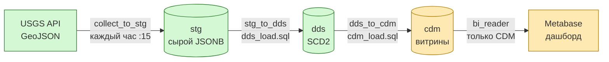
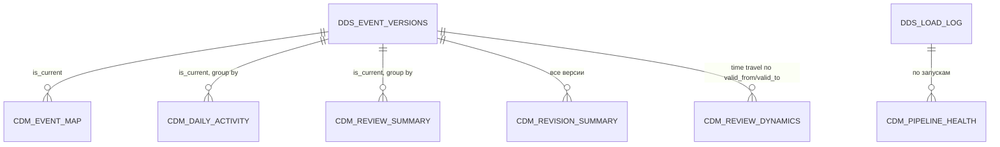

# План роли 3: CDM-витрины и дашборд Metabase

Рабочий план участника 3, составленный до реализации. **План выполнен 28.10.2026.**
Актуальное описание витрин и дашбордов — [dashboard.md](dashboard.md).
Итоговая модель немного отличается от плана:
добавлены `event_history` и `data_quality`, макет дашборда разнесён на вкладки.

## 1. Контекст: что уже есть



| Слой | Кто | Статус | Что важно для роли 3 |
|---|---|---|---|
| Docker, Airflow, STG | Роль 1 (Елизавета) | готово, проверено на живом USGS | DAG уже вызывает `sql/cdm_load.sql` третьим шагом; пока файл пустой — задача skipped |
| DDS, SCD2 | Роль 2 (Лена) | готово, 17 проверок | читать `dds.event_versions`, **для счётчиков и карты — только `is_current = true`** |
| CDM, Metabase | Роль 3 | **предстоит** | `sql/cdm_load.sql`, `docs/dashboard.md`, скриншоты, проверки |

Исходная постановка ([kinomant/airflow_workshop](https://github.com/kinomant/ppa-for-da/tree/master/airflow_workshop))
требует: витрины в слое CDM, строятся **только из DDS**; дашборд в Metabase; доли,
динамика долей и разрезы. Команда заменила учебные планы на землетрясения USGS,
поэтому на защите полезно показать соответствие требований (раздел 4).

### Что даёт DDS (вход для CDM)

| Таблица | Поля, которые используем |
|---|---|
| `dds.event_versions` | `event_id, event_time, magnitude, magnitude_type, depth_km, longitude, latitude, place, event_type, review_status, network_code, tsunami_flag, alert_level, source_updated_at, valid_from, valid_to, is_current` |
| `dds.events` | `first_observed_at` — когда пайплайн впервые увидел событие |
| `dds.dim_network`, `dds.dim_event_type` | справочники для фильтров |
| `dds.load_log` | сколько прочитано / отбраковано / создано версий за запуск |
| `dds.rejected_observations` | причины отбраковки (качество данных) |

Нормализация уже сделана ролью 2: `review_status`, `event_type`, `network_code` в нижнем
регистре, пустые → `'unknown'`; магнитуда и глубина могут быть NULL.

## 2. Правила для всех витрин

1. Источник — только схема `dds`. Ни одного обращения к `stg`.
2. Счётчики событий, карта, доли — по `is_current` (иначе SCD2 завысит числа).
   Метрики уточнений и динамика — по всем версиям, это и есть ценность SCD2.
3. Аналитика — только `event_type = 'earthquake'` (взрывы, карьеры — в отдельной карточке-сноске).
4. NULL-магнитуда — отдельная категория `'нет данных'`, не теряется и не нулится.
5. Знаменатель доли reviewed — все события группы, включая `automatic` и `deleted`.
6. Загрузка идемпотентна: `CREATE TABLE IF NOT EXISTS` + `TRUNCATE` + `INSERT` в одной
   транзакции. Таблицы не пересоздаём через DROP — так Metabase сохраняет id полей и
   карточки не ломаются после перезапуска.
7. В конце файла `GRANT SELECT ON ALL TABLES IN SCHEMA cdm TO bi_reader` (страховка к default privileges).
8. COMMIT не пишем — `run_sql_file` выполняет файл одной транзакцией.

Справочные классы (вычисляются в CDM, одинаковы во всех витринах):

| Признак | Классы |
|---|---|
| `mag_class` | `<2.5`, `2.5–4`, `4–5`, `5–6`, `6+`, `нет данных` |
| `depth_class` | мелкофокусные `<70 км`, промежуточные `70–300`, глубокофокусные `>300`, `нет данных` |
| `region_cell` | ячейка 10°×10° по широте/долготе (`place` — свободный текст, страны в API нет) |

## 3. Витрины CDM



| # | Таблица | Зерно | Основные поля | Зачем на защите |
|---|---|---|---|---|
| 1 | `cdm.event_map` | одно текущее землетрясение | время, lat/lon, магнитуда, глубина, классы, статус, сеть, place, tsunami, alert, `versions_cnt` | карта мира, основной «вау» |
| 2 | `cdm.daily_activity` | дата UTC × `mag_class` | `events_cnt`, `avg/max_mag`, `avg/max_depth`, `reviewed_cnt` | динамика активности |
| 3 | `cdm.review_summary` | дата события × сеть | `events_cnt`, `reviewed_cnt`, `reviewed_share`, `automatic_cnt`, `deleted_cnt` | аналог «доли одобренных» |
| 4 | `cdm.revision_summary` | событие с ≥1 наблюдением | `versions_cnt`, `first_mag`, `current_mag`, `mag_delta`, `first_status`, `current_status`, `first_depth`, `current_depth`, `hours_to_review` | что изменилось за время наблюдения |
| 5 | `cdm.review_dynamics` | срез на момент наблюдения (час) × `mag_class` | доля reviewed среди событий, текущих **на тот момент** | демонстрация SCD2 time travel |
| 6 | `cdm.pipeline_health` | запуск `dds.load_log` + сводка отбраковки | прочитано, отбраковано, устарело, новых событий, версий создано/закрыто | показать, что конвейер живой и идемпотентный |

Набросок ключевой витрины time travel (идея, не финальный код):

```sql
-- Срезы: каждый час наблюдения пайплайна.
WITH snap AS (
    SELECT generate_series(date_trunc('hour', min(valid_from)),
                           max(valid_from), interval '1 hour') AS snapshot_at
    FROM dds.event_versions
)
SELECT s.snapshot_at, <mag_class>,
       count(*)                                              AS events_cnt,
       count(*) FILTER (WHERE v.review_status = 'reviewed')  AS reviewed_cnt
FROM snap s
JOIN dds.event_versions v
  ON s.snapshot_at >= v.valid_from AND s.snapshot_at < COALESCE(v.valid_to, 'infinity')
WHERE v.event_type = 'earthquake'
GROUP BY 1, 2;
```

Витрина 5 полезна, только если пайплайн проработал хотя бы несколько часов: чем дольше
работает DAG до защиты, тем нагляднее график. **Не останавливать Docker до защиты.**

## 4. Дашборд: соответствие исходным требованиям

| Требование исходной лабы | Наш аналог | Карточка |
|---|---|---|
| Доля планов «одобрено» | доля землетрясений `reviewed` | KPI + столбцы по сетям |
| Доля планов с некорректной трудоёмкостью | доля отбракованных/неполных наблюдений (вне диапазона, нет магнитуды) | KPI + таблица причин |
| Динамика доли заполненных аннотаций | динамика доли событий с заполненными `magnitude`/`place`/`alert` | линия по дням |
| Динамика доли одобренных дисциплин | динамика доли reviewed во времени наблюдения (SCD2) | линия по часам |
| Разрез «подразделение» | сеть `network_code` (us, ak, nc, ci, …) | фильтр |
| Разрез «уровень образования» | класс магнитуды / глубины | фильтр |
| Разрез «учебный год» | дата события (период) | фильтр |

### Макет дашборда «Сейсмическая активность USGS»

```text
┌──────────────────────────────────────────────────────────────────────────────┐
│ Фильтры:  [Дата события ▾]  [Магнитуда от–до]  [Сеть ▾]  [Класс глубины ▾]    │
├────────────┬────────────┬────────────┬────────────┬──────────────────────────┤
│ Событий    │ Макс. M    │ Доля       │ Уточнено   │ Последняя загрузка        │
│ 33 662     │ 7.1        │ reviewed   │ событий    │ 2026-10-28 09:15 UTC      │
│            │            │ 74 %       │ 1 204      │                           │
├────────────┴────────────┴────────────┴────────────┴──────────────────────────┤
│ 1. Карта: точки (pin map) / тепловая сетка, цвет = магнитуда                  │
├───────────────────────────────────────┬──────────────────────────────────────┤
│ 2. Событий в день, stacked по mag_class│ 3. Доля reviewed по сетям (bar)       │
├───────────────────────────────────────┼──────────────────────────────────────┤
│ 4. Доля reviewed vs возраст события    │ 5. Динамика доли reviewed по часам    │
│    (automatic → reviewed со временем)  │    наблюдения (SCD2 time travel)      │
├───────────────────────────────────────┼──────────────────────────────────────┤
│ 6. Распределение глубины × магнитуды   │ 7. Топ уточнений: first→current M     │
│    (scatter)                           │    (таблица + гистограмма Δ M)        │
├───────────────────────────────────────┴──────────────────────────────────────┤
│ 8. Здоровье конвейера: запуски, версии создано/закрыто, отбраковка (таблица)  │
└──────────────────────────────────────────────────────────────────────────────┘
```

Числа в макете условные. Фильтры дашборда связать со всеми карточками, где есть поле.
У полей `latitude`/`longitude` в Metabase (Admin → Table Metadata) выставить семантический
тип Latitude/Longitude, иначе карта не построится.

Дополнительно к Metabase (по желанию, если останется время): схема архитектуры для защиты —
одна картинка «как всё устроено» (диаграмма из раздела 1 + Airflow-граф задач).

## 5. Шаги реализации

| # | Шаг | Результат | Проверка |
|---|---|---|---|
| 0 | `git switch -c role3/cdm-dashboard`; запустить Docker Desktop, `docker compose up -d` | окружение поднято | `docker compose ps`, DAG зелёный до `stg_to_dds` |
| 1 | Посмотреть реальные данные в DBeaver (`localhost:15433`, lab/lab_password): значения `review_status`, сети, распределение магнитуд, сколько событий имеют >1 версии | понимание данных | запросы раздела «Запросы» в [dds.md](dds.md) |
| 2 | `sql/cdm_load.sql`: DDL + загрузка шести витрин | файл | ручной прогон `psql < sql/cdm_load.sql` дважды без ошибок |
| 3 | Перезапустить DAG (Trigger) | `dds_to_cdm` — success | Airflow Graph |
| 4 | `scripts/check_cdm.py` по образцу `check_dds.py`: числа CDM = числам DDS (`is_current`), повтор не меняет витрины, NULL-магнитуда не теряется, `bi_reader` видит CDM и не видит STG/DDS | скрипт | все проверки PASS |
| 5 | Metabase: регистрация, подключение `warehouse:5432` / `bi_reader`, Sync, метаданные полей | источник данных | в Metabase видна только схема `cdm` |
| 6 | Собрать 8 карточек + KPI + фильтры, сохранить SQL каждой карточки | дашборд | фильтры меняют все карточки |
| 7 | `docs/dashboard.md`: DDL, SQL карточек, метрики и NULL, шаги воспроизведения, скриншоты в `docs/img/` | документация | новый человек воспроизводит дашборд |
| 8 | README: статус роли 3, раздел «Что сделано ролью 3»; `docs/validation.md`: результаты проверок | обновлённые доки | — |
| 9 | Commit, push, PR в `main` | PR | ревью коллег |

## 6. Сценарий защиты (ориентир 10 минут, показывать с одного ноутбука)

1. **Архитектура** (1 мин): схема из раздела 1, кто за что отвечал.
2. **Airflow** (`localhost:8081`): граф `collect_to_stg → stg_to_dds → dds_to_cdm`, история
   часовых запусков, логи. Рассказывает роль 1 (если Елизавета на работе — показываем по её подсказкам).
3. **DBeaver**: `stg.earthquake_raw` (сырой JSON) → `dds.event_versions` (история одного
   уточнённого события, time travel) → `cdm.*`. Рассказывает роль 2.
4. **Metabase**: дашборд, фильтры по дате и магнитуде, карта, динамика reviewed. Роль 3.
5. **Проверки**: `check_dds.py`, `check_cdm.py`; повторный запуск DAG не создаёт дублей;
   `bi_reader` не видит STG/DDS.

Вопросы, к которым стоит быть готовым:

- Почему считаем по `is_current`? — Иначе каждое уточнение даёт ещё одну строку и завышает число событий.
- Что будет при повторном запуске? — Витрины пересобираются целиком в одной транзакции, результат тот же.
- Почему доля reviewed у свежих событий ниже? — USGS проверяет события вручную с задержкой; карточка 4 это показывает.
- Почему нет стран? — В API нет надёжного поля страны; `place` — свободный текст, поэтому регионы — по координатам.
- Откуда взялись уточнения? — Только за период наблюдения нашим пайплайном; прошлые правки USGS API не отдаёт.

## 7. Риски и решения

| Риск | Решение |
|---|---|
| Мало версий в SCD2 (DAG работал недолго) | DAG крутить непрерывно до защиты; в витрине 5 показать хотя бы ночь наблюдения |
| Docker на ноутбуке не тянет / мало места | 8 ГБ RAM Docker, `docker system prune` (без `-v`!) |
| Metabase не строит карту | семантические типы Latitude/Longitude у полей |
| Настройки Metabase не переносятся через Git | все шаги и SQL карточек в `dashboard.md`; защищаемся с одного ноутбука |
| `down -v` стирает историю | никогда не добавлять `-v` |
